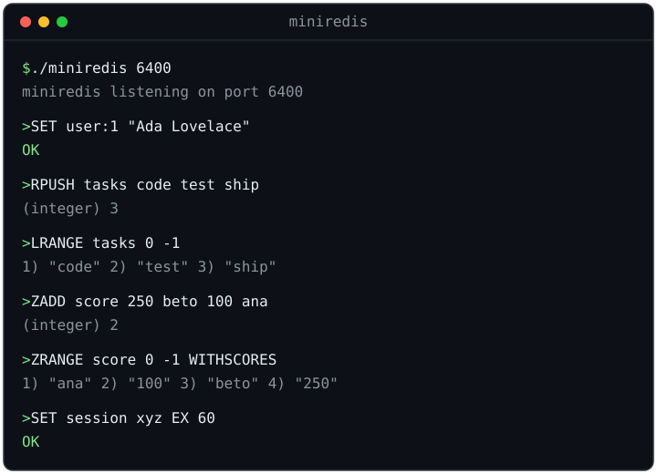

# miniredis

[](https://github.com/ccchimi/miniredis/actions/workflows/ci.yml)

A small, from-scratch **key-value store server written in modern C++20**, wire-compatible with the [Redis](https://redis.io) protocol (RESP2). Because it speaks the real protocol, you can talk to it with the official `redis-cli` and drive load against it with `redis-benchmark`.

This is a learning-oriented reimplementation of the core ideas behind an in-memory data store: TCP networking, protocol parsing, concurrent access to shared state, and a clean layered design.

<p align="center">
  
</p>

## Features

- **RESP2 protocol** — connect with the standard `redis-cli`, no custom client needed
- **Concurrent** — one thread per client over a store split into independently-locked shards, so operations on different keys run in parallel
- **Incremental parser** — correctly handles TCP fragmentation (half commands, batched commands)
- **Data types** — strings, lists, hashes, and sorted sets, with `WRONGTYPE` errors when a command targets the wrong type
- **Key expiration (TTL)** — both passive (evicted on access) and active (a background sweeper thread), just like Redis
- **Persistence** — the keyspace is snapshotted to disk and restored on restart, with TTLs preserved
- **Cross-platform** — the socket layer builds on Windows (Winsock), Linux, and macOS (POSIX)
- **Fast** — a bundled benchmark sustains ~235k ops/sec over 50 concurrent clients
- **Zero dependencies** beyond the standard library and the OS sockets API

## Commands

**Strings & keys**

| Command | Description |
|---------|-------------|
| `PING [msg]` | Health check; replies `PONG` or echoes `msg` |
| `ECHO msg` | Returns `msg` |
| `SET key value [EX secs \| PX ms]` | Stores a string, optionally with a time-to-live |
| `GET key` | Returns the value, or nil if missing/expired |
| `DEL key [key ...]` | Deletes keys; returns how many existed |
| `EXISTS key [key ...]` | Returns how many of the keys exist |
| `TYPE key` | Returns the key's type (`string`, `list`, `hash`, or `none`) |
| `EXPIRE key secs` / `PEXPIRE key ms` | Sets a TTL on an existing key |
| `TTL key` / `PTTL key` | Remaining life in seconds / ms (`-1` no expiry, `-2` no key) |
| `PERSIST key` | Removes a key's TTL so it never expires |
| `DBSIZE` | Number of keys currently stored |

**Lists**

| Command | Description |
|---------|-------------|
| `LPUSH key v [v ...]` / `RPUSH key v [v ...]` | Push values to the head / tail; returns the new length |
| `LPOP key [count]` / `RPOP key [count]` | Pop from the head / tail (one, or `count`) |
| `LRANGE key start stop` | Elements in a range (negative indices count from the end) |
| `LLEN key` | Number of elements |

**Hashes**

| Command | Description |
|---------|-------------|
| `HSET key field value [field value ...]` | Set fields; returns how many were newly added |
| `HGET key field` | Returns a field's value, or nil |
| `HDEL key field [field ...]` | Deletes fields; returns how many existed |
| `HEXISTS key field` | 1 if the field exists, else 0 |
| `HLEN key` | Number of fields |
| `HGETALL key` | All field/value pairs |

**Sorted sets** (members ordered by a numeric score)

| Command | Description |
|---------|-------------|
| `ZADD key score member [score member ...]` | Add/update members; returns how many were newly added |
| `ZSCORE key member` | A member's score, or nil |
| `ZRANK key member` | 0-based rank by ascending score, or nil |
| `ZRANGE key start stop [WITHSCORES]` | Members in a rank range, ascending |
| `ZREM key member [member ...]` | Removes members; returns how many existed |
| `ZCARD key` | Number of members |

Operating on a key with a command for the wrong type returns a `WRONGTYPE` error, as in Redis.

## Architecture

The code is split into layers so each piece can be understood and tested on its own:

| File | Responsibility |
|------|----------------|
| `store.{hpp,cpp}` | Sharded, thread-safe store: strings/lists/hashes, TTLs, and snapshot save/load |
| `resp.{hpp,cpp}` | RESP protocol parsing and reply encoding (the wire format) |
| `commands.{hpp,cpp}` | Command execution — pure logic, knows nothing about sockets |
| `server.{hpp,cpp}` | TCP accept loop and per-client threads (the networking) |
| `net.hpp` | Cross-platform socket shim (Winsock / POSIX) |
| `main.cpp` | Entry point / argument parsing |

The `commands` layer takes a `Store` and a parsed argument list and returns reply bytes, so it can be unit-tested without any network.

## Build

Requires a C++20 compiler and CMake 3.15+.

```bash
cmake -S . -B build
cmake --build build
```

On Windows with MinGW, add `-G "MinGW Makefiles"` to the configure step.

## Run

```bash
./build/miniredis        # listens on port 6379 (Redis default)
./build/miniredis 6400   # or a port of your choice
```

Then talk to it. The canonical client is the official **`redis-cli`**, since the
server speaks the real RESP protocol:

```bash
redis-cli -p 6379
> SET name Ada
OK
> GET name
"Ada"
> EXISTS name missing
(integer) 1
```

### No Redis installed? (`tools/mini-cli.ps1`)

If you just want to try the server on Windows without installing Redis, a small
interactive client is included as a convenience. It is not part of the server —
just a demo helper that speaks the same protocol:

```powershell
# Terminal 1: start the server
./build/miniredis 6400
# Terminal 2: connect and type commands
powershell -ExecutionPolicy Bypass -File ./tools/mini-cli.ps1 -Port 6400
```

On Windows you can also just double-click **`run-server.bat`** to start the
server and **`run-client.bat`** to open the client (both default to port 6400).

## Persistence

The keyspace is saved to a snapshot file (`dump.mrdb` by default; pass a path as
the second argument). A background thread writes a fresh snapshot every few
seconds, but only when something has actually changed. On startup the server
loads the snapshot, so data survives a restart:

```bash
./build/miniredis 6400 mydata.mrdb
# SET some keys, wait a few seconds, stop the server, start it again —
# the keys are still there, and any TTLs resume from where they left off.
```

The format is a compact, length-prefixed binary layout, written atomically
(temp file + rename) so a crash mid-save cannot corrupt the previous snapshot.
Expiry is stored as remaining time, so a key that had 40s left still has ~40s
after a reload.

## Tests

Unit tests cover the store, the RESP parser/encoder, command execution, and
snapshot save/load.
Because the logic lives in a `miniredis_core` library separate from the socket
layer, the tests run with no network involved, on any platform:

```bash
cmake -S . -B build
cmake --build build
ctest --test-dir build --output-on-failure
```

Every push runs them on Linux and Windows via GitHub Actions (see the badge above).

## Benchmarks

A bundled load generator (`bench/bench.cpp`) opens many concurrent connections
and fires synchronous commands, reporting aggregate throughput. Start the server,
then run the benchmark against it:

```bash
./build/miniredis 6400                     # terminal 1
./build/miniredis_bench 6400 50 200000     # terminal 2: port, clients, requests
```

Representative results on the development machine (Windows, MinGW GCC 16,
thread-per-client, over loopback), 50 concurrent clients:

| Workload | Throughput |
|----------|------------|
| `SET`    | ~235,000 ops/sec |
| `GET`    | ~235,000 ops/sec |

Numbers vary by hardware — run it on yours. The point is that the sharded store
and per-client threads sustain hundreds of thousands of operations per second
without an event loop.

## Roadmap

- [x] **Phase 1** — TCP server, RESP protocol, core commands, concurrency
- [x] **Phase 2** — key expiration (TTL): `SET ... EX/PX`, `EXPIRE`, `TTL`, `PERSIST`, passive + active eviction
- [x] **Phase 4** — unit tests + CI (GitHub Actions on Linux & Windows)
- [x] **Phase 3** — persistence: atomic binary snapshots, restored on startup, TTLs preserved
- [x] **Phase 5** — portable socket layer (Winsock + POSIX): the server builds and runs on Windows, Linux, and macOS
- [x] **Phase 6** — sharded locking: the keyspace is split into independently-locked partitions for parallel access
- [x] **Phase 7** — data types: lists and hashes, `TYPE`, and `WRONGTYPE` errors
- [x] **Phase 8** — a concurrent benchmark client and published throughput numbers
- [x] **Phase 9** — sorted sets: `ZADD`, `ZSCORE`, `ZRANK`, `ZRANGE` (WITHSCORES), `ZREM`, `ZCARD`
- [ ] **Next ideas** — an event loop (epoll/IOCP) instead of thread-per-client, replication

Notes on current trade-offs, worth revisiting as the project grows:
- The active expiration sweep scans all keys each tick; Redis instead samples a
  random subset to bound per-tick work.
- Snapshots persist the whole keyspace periodically; writes in the last few
  seconds before a crash can be lost. An append-only log would tighten this.

## License

MIT
